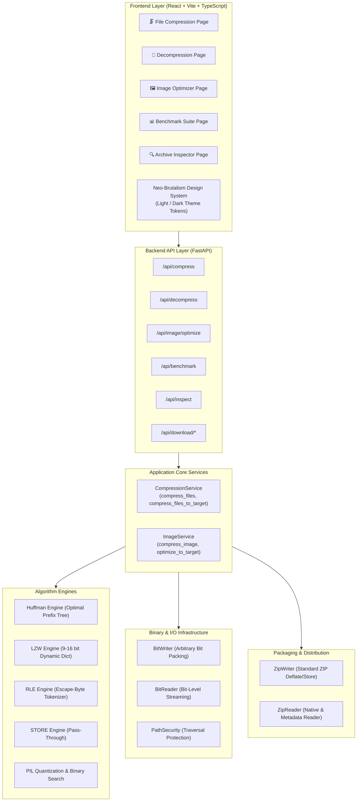

# ⚡ ZipForge v2.0

<div align="center">

### Adaptive Multi-Engine File Compressor & Image Optimizer
**Crafted with a Premium Neo-Brutalism Design System**

[](https://www.python.org/)
[](https://fastapi.tiangolo.com)
[](https://react.dev/)
[](https://vitejs.dev/)
[](tests)
[](frontend)
[](https://en.wikipedia.org/wiki/ZIP_(file_format))
[](LICENSE)

<p align="center">
  <b>ZipForge</b> is a high-performance file compression platform that combines classical computer science algorithms (Huffman, LZW, RLE) with intelligent target-size optimization, universal ZIP archiving, and a distinctive <b>Neo-Brutalist user interface</b> with persistent light and dark themes.
</p>

[Key Features](#-key-features) •
[Architecture](#-system-architecture) •
[Neo-Brutalism Design System](#-neo-brutalism-design-system) •
[Getting Started](#-getting-started) •
[Project Structure](#-project-structure) •
[Testing](#-testing)

</div>

---

## 🌟 Overview

Most compression utilities hide their algorithms behind closed binaries. **ZipForge** opens the hood while delivering production-grade utility:

1. **Custom Algorithmic Engines**: Built-from-scratch implementations of **Huffman Coding**, **Lempel-Ziv-Welch (LZW)**, and **Run-Length Encoding (RLE)** operating on arbitrary binary streams with custom bit-level I/O.
2. **Auto-Algorithm Selection**: Automatically evaluates every algorithm against input data and chooses the strategy that yields the greatest reduction.
3. **Smart Target-Size Mode**: Need a file under 500 KB for an upload portal? ZipForge tries lossless algorithms first, then uses binary-search lossy re-encoding (for images) to hit your exact size budget.
4. **Direct Same-Extension Downloads**: Upload `.jpeg`, compress it, and download it directly as `.jpeg`—no unzipping required.
5. **Universal `.zip` Archive Output**: Multi-file archives are 100% compliant standard `.zip` files. When extracted with Windows Explorer, WinRAR, 7-Zip, or macOS Archive Utility, files retain their original names and open instantly.
6. **Defensive Security & Integrity**: SHA-256 checksum verification on every file, path traversal defense, and bounded memory execution.
7. **Clean Two-Tier Full-Stack Architecture**: Clean separation into `frontend/` (React + TypeScript + Vite + Vanilla CSS) and `backend/` (FastAPI REST service wrapping the core compression engines).

---

## ✨ Key Features

| Feature | Description |
| :--- | :--- |
| ⚡ **Auto-Algorithm Engine** | Automatically tests Huffman, LZW, RLE, and STORE to select the optimal ratio per file. |
| 🎯 **Target-Size Budgeting** | Specify a target size in KB or MB; ZipForge guarantees output within budget. |
| 💾 **Same-Extension Downloads** | Single-file downloads preserve their original extension (`.jpg`, `.png`, `.pdf`, `.txt`). |
| 📦 **Universal ZIP Compatibility** | Clean `.zip` entries with no proprietary extensions or corrupting prefixes. |
| 🖼️ **Dedicated Image Optimizer** | Profile-based optimization (Web, Print, High Fidelity) with transparency preservation. |
| 📊 **Interactive Benchmark** | Side-by-side algorithm comparison with real-time compression ratios and execution times. |
| 🔍 **Zero-Extraction Inspector** | Inspect archive headers, entry count, compressed sizes, and SHA-256 without unpacking. |
| 🌓 **Functional Light / Dark Themes** | Seamless Neo-Brutalist themes with anti-flash script and local storage persistence. |
| 🔒 **Enterprise-Grade Security** | Strict path sanitization, traversal defense, and SHA-256 cryptographic verification. |

---

## 🏗 System Architecture



---

## 🎨 Neo-Brutalism Design System

The application interface is styled with a distinct **Neo-Brutalist visual identity**:

- **Borders**: 2.5px solid high-contrast borders (`#121316` in light mode, `#E2E8F0` in dark mode).
- **Hard Offset Shadows**: Crisp 4px / 6px offset shadows (`4px 4px 0px #000`) with zero blur for an expressive, physical feel.
- **Tactile Micro-interactions**: Interactive buttons shift on click (`transform: translate(2px, 2px); box-shadow: 1px 1px 0px #000;`).
- **Color Palettes**:
  - **Light Mode**: Warm cream/off-white background (`#F6F4EE`), Electric Yellow (`#FFE600`), Vivid Coral (`#FF5A36`), Mint Green (`#00E599`), Cyan (`#00D2FF`).
  - **Dark Mode**: Deep charcoal/graphite (`#0C0E12`), Slate surface (`#151820`), vivid neon accents.
- **Typography**: Display headings powered by `Space Grotesk`, clean body text in `Plus Jakarta Sans`, and data telemetry in `JetBrains Mono`.
- **Persistent Theme Switcher**: Sun ☀️ / Moon 🌙 toggle in the top navigation bar, with OS preference detection and inline script to prevent theme flash.

---

## 🚀 Getting Started

### Prerequisites

- Python 3.11+
- Node.js 18+ and npm

### 1. Backend Setup

```bash
cd backend
python -m venv .venv
# On Windows:
.venv\Scripts\activate
# On Linux/macOS:
source .venv/bin/activate

pip install -r requirements.txt
python -m uvicorn main:app --host 127.0.0.1 --port 8000 --reload
```

The FastAPI backend will start at `http://127.0.0.1:8000`. You can inspect the Swagger documentation at `http://127.0.0.1:8000/docs`.

### 2. Frontend Setup

```bash
cd frontend
npm install
npm run dev
```

The Vite dev server will start at `http://127.0.0.1:5173`. Open your browser to access ZipForge!

To create a production build of the frontend:
```bash
npm run build
```

---

## 📁 Project Structure

The repository is organized around a clean two-tier layout:

```
ZipForge/
├── .gitignore
├── .env.example
├── pyproject.toml              # Pytest and linter configuration
├── README.md                   # Project documentation
│
├── frontend/                   # Frontend Web Application (React + Vite + TS)
│   ├── package.json
│   ├── vite.config.ts
│   ├── index.html              # HTML with anti-flash theme script
│   ├── src/
│   │   ├── App.tsx             # Root application orchestrator
│   │   ├── main.tsx            # React DOM mounting
│   │   ├── components/         # Reusable Neo-Brutalist UI components
│   │   │   └── ui/             # Button, Card, Badge, MetricCard, FileDropzone, etc.
│   │   ├── pages/              # Compress, Decompress, ImageOptimizer, Benchmark, Inspect
│   │   ├── hooks/              # useTheme, custom hooks
│   │   ├── styles/             # design-tokens.css, neo-brutalism.css
│   │   ├── types/              # TypeScript schemas for all API payloads
│   │   └── utilities/          # API client, formatters, download helpers
│   └── public/
│
└── backend/                    # Backend API and Compression Engines (FastAPI)
    ├── main.py                 # FastAPI application entrypoint
    ├── requirements.txt        # Backend dependencies
    ├── config.py               # Constants, format caps, quality defaults
    ├── exceptions.py           # Custom exception hierarchy
    ├── api/                    # REST route controllers
    │   ├── compress.py         # Multi-file and target-size compression
    │   ├── decompress.py       # Archive preview and in-memory extraction
    │   ├── image.py            # Image optimization and binary-search budgeting
    │   ├── benchmark.py        # Multi-engine side-by-side benchmarking
    │   ├── inspect.py          # Zero-extraction manifest inspection
    │   ├── download.py         # Streaming artifact download endpoints
    │   └── cache.py            # In-memory artifact cache with TTL cleanup
    ├── algorithms/             # Huffman, LZW, RLE, STORE, Registry
    ├── application/            # CompressionService, ImageService
    ├── archive/                # ZipWriter, ZipReader
    ├── binary/                 # BitWriter, BitReader
    ├── filesystem/             # Path security and traversal defense
    ├── image/                  # PIL quantization and profile pipelines
    ├── integrity/              # SHA-256 cryptographic hashing
    ├── models/                 # Domain models and dataclasses
    └── tests/                  # 107 integration and unit tests
```

---

## 🧪 Testing

ZipForge comes with a comprehensive test suite of **107 tests** covering algorithm roundtrips, edge cases, corrupted archive detection, path traversal attacks, and API integration.

To run the complete test suite:

```bash
# From repository root or backend directory:
pytest
```

Output:
```
======================= 107 passed in 1.81s =======================
```
